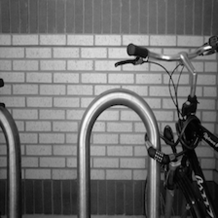
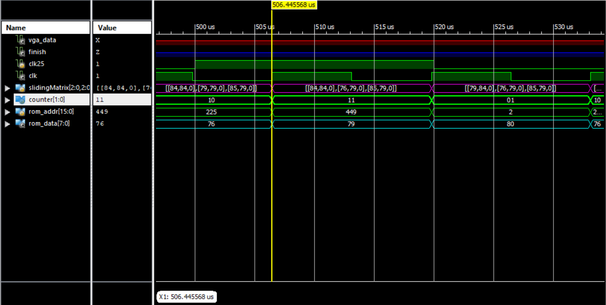

# FPGA Image Processing — VGA Display and a 3×3 Median Filter in Verilog

FPGA laboratory course (آزمایشگاه FPGA) — B.Sc. Electrical Engineering, Isfahan University of Technology,
term 4012 (Fall 2022). Two related RTL designs in Verilog, targeting the lab's Xilinx board through the ISE flow.

**One-page overview (PDF): [`docs/project-overview.pdf`](docs/project-overview.pdf)** ·
**My submitted pre-report (PDF, Persian): [`reports/PreReport7_rabbani.pdf`](reports/PreReport7_rabbani.pdf)**

---

## What this repository contains

| Experiment | Design | Highlights |
|---|---|---|
| **Exp 6 — VGA display** | `exp6-vga/` | Reading a 224×224 test image out of a block-memory ROM and displaying it on a VGA monitor: pixel generator, VGA sync generators, clock generation from the 24 MHz board clock, pin constraints |
| **Exp 7 — image processing** | `exp7-median-filter/` | A hardware **3×3 median filter** streaming pixels out of a ROM: line/column window shifting, median extraction with a compare-and-swap network, simulated with a Verilog testbench |

## Design 1 — VGA image display (`exp6-vga/`)

| File | Role |
|---|---|
| `Top.v` | Top level: instantiates the clock wizard (24 MHz board clock → 25 MHz and 40 MHz), the image ROM and the pixel generator |
| `pixel_gen.v` | Pixel generator: walks the image stored in the ROM and drives the RGB outputs for the visible part of the frame |
| `sync.v`, `sync40.v` | VGA horizontal/vertical synchronisation generators (pixel clock variants) |
| `Top.ucf` | Pin and clock constraints for the lab board |
| `prelab/` | My pre-lab Verilog (VGA synchronisation module, pixel generation, testbench) |
| `ipcore/` | Regeneration sources of the two IP cores used (clock generator, image ROM) |

The image data lives in the block RAM initialised from the `.coe` files kept in [`data/`](data):
five 3-bit test patterns (`img_1.coe` … `img_5.coe`, depth 50176 = 224×224) and two 8-bit images.

## Design 2 — 3×3 median filter (`exp7-median-filter/`)

The design streams pixels from a ROM and computes the median of every 3×3 neighbourhood on the fly:

```verilog
module Median_Filter(
    input  clk,
    output reg [7:0] output_data,     // filtered pixel stream
    output op_finished,
    output reg flag = 1'b0
);
    reg  [15:0] addr = 16'h0000;      // ROM address counter
    reg  [15:0] comp = 16'h029F;      // 671 = end of the third line of the 224-wide image
    wire [7:0]  dout;                 // ROM output
    reg  [7:0]  Q0, Q1, Q2, Q3, Q4, Q5, Q6, Q7, Q8;   // the 3x3 window
    reg  [7:0]  pic_mat [2:0][2:0];
    reg  [3:0]  state = 4'h0;
    ...
```

* **Clock generation:** IP core clock wizard producing `clk25` (image pipeline) and `clk75` from the board clock.
* **Storage:** block-memory ROM, 8-bit wide and 50176 deep — the 224×224 grayscale image in
  [`exp7-median-filter/Rom.mif`](exp7-median-filter/Rom.mif).
* **Windowing:** nine registers hold the 3×3 neighbourhood; the columns are shifted one position per clock after
  every third clock, so a complete window is available without frame buffering.
* **Median extraction:** the median of the nine values is produced with a compare-and-swap network over the
  window registers (Q0 … Q8), writing the filtered pixel into `output_data` together with the `op_finished` flag.
* **Simulation:** `exp7_q2_test.v` / `exp7_q2test.v` are the testbenches used to verify the filter before
  programming the device; the waveform captured from the simulation is in
  [`docs/images/model-sim-waveform.png`](docs/images/model-sim-waveform.png).

## Test data (224 × 224, 8-bit and 3-bit)

The images below were **decoded from the `.coe` ROM files committed in [`data/`](data)** with a small script, so the
repository shows what the designs actually process:

| Median-filter input (noisy) | Edge-detection test image | 3-bit test pattern (`img_1.coe`) |
|---|---|---|
|  |  |  |

These are the course's test vectors, kept so the designs can be rebuilt as they were submitted.

## Simulation waveform



## How to build

1. Open `exp6-vga/exp6_VGA.xise` or `exp7-median-filter/exp7_imageProcessing_Median.xise` with **Xilinx ISE**
   (14.x, the flow this course used) — the `.xise` project files, sources, constraints and IP regeneration
   sources are all included.
2. Regenerate the IP cores (clock wizard / block memory generator) from the `.xco` files in `ipcore/`, since
   generated netlists and vendor documentation are not committed.
3. Run synthesis + implementation and program the board, or run the testbenches with ISim.
4. The ROM contents come from the files in `data/` (`.coe`) and `exp7-median-filter/Rom.mif`.

> The vendor build trees (`_xmsgs`, `.ngd/.ncd`, ISim output, Xilinx IP documentation) and the course handouts are
> deliberately not committed; the test images are the lab's provided data, kept so the designs are reproducible.

## Skills demonstrated

`Verilog RTL design` · `FPGA design flow (Xilinx ISE: synthesis, UCF constraints, implementation)` ·
`VGA timing and synchronisation` · `clock generation with IP cores (clock wizard)` ·
`block memory / ROM-based image storage` · `streaming image processing on FPGA` · `3×3 windowing with line/column
shifting` · `median filter as a compare-and-swap network` · `Verilog testbenches and waveform-based verification` ·
`hardware/software trade-offs in embedded vision`

## Context and licence

Laboratory work for the FPGA course at Isfahan University of Technology (term 4012, Fall 2022), carried out
individually. Published as a portfolio piece; the course handouts and the work of other students are not included.
Code released under the [MIT licence](LICENSE); the submitted report is © Kiavash Rabbani Soudabi.
